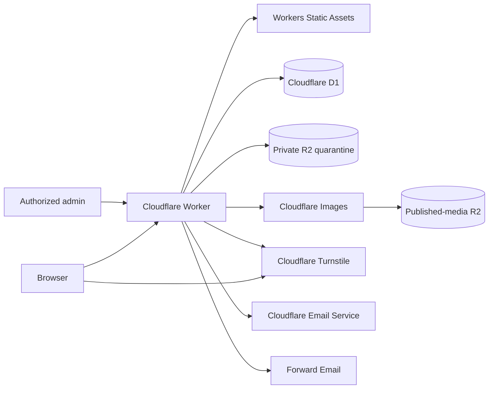

# Serve the Cays

**Find a cause. Meet your community. Make a difference across The Bahamas.**

Serve the Cays helps people find organizations, discover events, and take part
in their communities. This repository shares the application code behind
[servethecays.com](https://servethecays.com/), including the website, member
experience, moderation tools, outreach ledger, and news publishing system.

[Visit the website](https://servethecays.com/) ·
[Organizations](https://servethecays.com/organizations) ·
[Events](https://servethecays.com/events) · [Run locally](#run-it-locally) ·
[Contribute](CONTRIBUTING.md)

[](https://servethecays.com/)

*Project illustration from [Caynetic.com](https://caynetic.com/#products).*

## What the codebase includes

- public organization and event directories with structured profiles;
- passwordless member accounts, saved listings, RSVPs, and suggestions;
- private submission review with quarantined uploads and sanitized public
  derivatives;
- a role-aware administration panel for moderation and subscriber management;
- a reliable outreach ledger with follow-up states and append-only activity
  evidence;
- draft, published, unpublished, and archived news posts;
- double-opt-in newsletter infrastructure, suppression handling, and delivery
  reconciliation;
- retention jobs, audit events, idempotency controls, and recovery-aware media
  cleanup.

Feature activation depends on the deployment's configuration and acceptance
checks. See [Deployment](#deployment) before enabling member or email features
on a fork. Keep live credentials, resource identifiers, personal information,
operational evidence, and recovery records outside Git.

## Documentation

| Guide | Start here for |
| --- | --- |
| [Local development](#run-it-locally) | Running an isolated copy with demonstration data |
| [Application guide](cloudflare/README.md) | Routes, member flows, authentication, and data lifecycle |
| [Architecture](docs/ARCHITECTURE.md) | Request, storage, media, email, and publishing boundaries |
| [Self-hosting](docs/SELF_HOSTING.md) | Configuring your own Cloudflare resources |
| [Deployment and recovery](cloudflare/ops/production-runbook.md) | Release gates, migrations, verification, and rollback |
| [Contributing](CONTRIBUTING.md) and [security](SECURITY.md) | Proposing changes and reporting vulnerabilities privately |

## How it is built

| Technology | Role in Serve the Cays |
| --- | --- |
| [Cloudflare Workers](https://developers.cloudflare.com/workers/) | TypeScript application runtime, routing, APIs, scheduled jobs, and server-rendered HTML |
| [Workers Static Assets](https://developers.cloudflare.com/workers/static-assets/) | CSS, JavaScript, fonts, and SVG delivery through the Worker |
| [Cloudflare D1](https://developers.cloudflare.com/d1/) | Listings, members, moderation, outreach, news, email jobs, consent, and audit state |
| [Cloudflare R2](https://developers.cloudflare.com/r2/) | Separate private-upload quarantine and published-media storage |
| [Cloudflare Images](https://developers.cloudflare.com/images/optimization/binding/) | Decode and re-encode approved uploads into bounded WebP derivatives |
| [Cloudflare Turnstile](https://developers.cloudflare.com/turnstile/) | Bot protection with server-side action and hostname verification |
| [Cloudflare Email Service](https://developers.cloudflare.com/email-service/) | Requested sign-in, RSVP, reminder, and submission-status messages |
| [Forward Email](https://forwardemail.net/en/email-api) | Newsletter sending, delivery-status readback, bounce/complaint events, and inbound aliases |
| [Tailwind CSS](https://tailwindcss.com/) | Compiled utility CSS alongside the existing site styles |
| [Vitest](https://vitest.dev/) and the [Cloudflare Workers test pool](https://developers.cloudflare.com/workers/testing/vitest-integration/) | Integration tests inside the Workers runtime |

The email providers have deliberately separate responsibilities. Cloudflare
Email Service handles transactional messages requested by a member action.
Forward Email handles newsletter delivery and human correspondence. D1 records
the application's delivery and suppression state; provider acceptance is never
treated as proof of inbox delivery.



See [Architecture](docs/ARCHITECTURE.md) for the request, media, email,
outreach, and publishing flows. The complete [self-hosting
guide](docs/SELF_HOSTING.md) explains how a fork is configured without placing
provider credentials in Git.

## Repository layout

```text
.
├── .github/                 CI and opt-in deployment workflows
├── docs/                    Public architecture documentation
└── cloudflare/
    ├── migrations/          Ordered D1 schema migrations
    ├── ops/                 Safe tooling and public release guidance
    ├── public/              Static assets
    ├── src/                 Worker application code
    ├── styles/              Tailwind source
    └── test/                Workers-runtime and static contract tests
```

## Run it locally

Requirements: a current Node.js runtime and npm.

```sh
cd cloudflare
npm install
cp .dev.vars.example .dev.vars
npm run db:migrate:local
npm run db:seed:local
npm run dev
```

Open `http://127.0.0.1:8787`. The local seed uses
`owner@example.test` for the owner allowlist. Local email is captured in the
development inbox and does not contact Cloudflare Email Service or Forward
Email.

The deeper [Cloudflare application guide](cloudflare/README.md) documents the
routes, data lifecycle, authentication boundaries, and complete local member
acceptance flow.

## Verify a change

```sh
cd cloudflare
npm run verify
```

That command compiles CSS, type-checks and bundles the production Worker
without deploying it, runs the integration and static-contract tests, and
checks the public repository candidate for private paths, live infrastructure
IDs, and common credential patterns.

## Deployment

Cloudflare continues to host the dynamic application; GitHub Pages cannot run
the Worker, D1, R2, image, authentication, or administration features. The
tracked GitHub workflow tests pushes but cannot deploy a fork by default.

After preview has been provisioned deliberately, a maintainer can configure
GitHub's `preview` and `production` environments and explicitly enable the
deployment workflow. Changes on `main` then release preview, while production
requires a manual dispatch, a recovery acknowledgement, and any protection
configured on the GitHub production environment.

Read [Self-hosting](docs/SELF_HOSTING.md) for configuration and
[Publishing](docs/PUBLISHING.md) before the first public release.

## Public repository boundary

The following developer and operator files are ignored:

- `.dev.vars` and other local secret files;
- `.wrangler/`, `node_modules/`, coverage, logs, and local databases;
- `wrangler.private.jsonc`, which holds provisioned resource IDs and reviewed
  release gates, and ephemeral `wrangler.ci.jsonc` materialized during a
  deployment job;
- `ops/private/`, which holds approvals, recovery bookmarks, release evidence,
  provider IDs, inventories, and production content batches;
- generated migration bundles and exports that may contain personal data.

The tracked `cloudflare/wrangler.jsonc` shows the full binding design but uses
placeholder IDs and keeps every preview and production feature gate off. The
public [deployment guide](cloudflare/ops/production-runbook.md) explains the
release and rollback model without authorizing a deployment or exposing a live
account.

The current-tree check does not rewrite or sanitize Git history. The first
public release must follow the fresh-history boundary in
[Publishing](docs/PUBLISHING.md).

## Contributing and security

Please read [CONTRIBUTING.md](CONTRIBUTING.md) before proposing a change. Report
security issues privately using [SECURITY.md](SECURITY.md), not a public issue.

## License

Serve the Cays is released under the [MIT License](LICENSE).

If the project is useful to you, you can [buy STC a Kalik](https://www.buymeacoffee.com/caynetic).
Support helps Caynetic Ltd. maintain and develop the open-source Serve the Cays
software.
