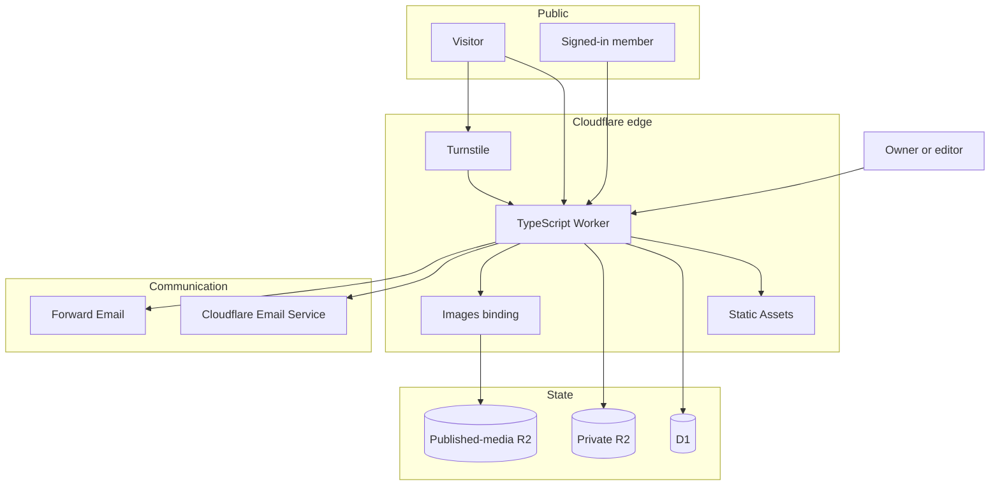
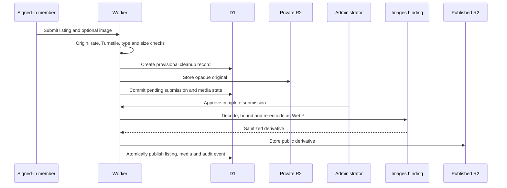
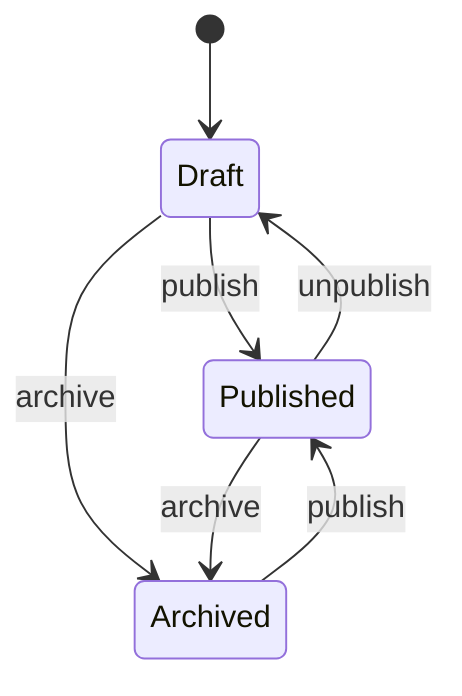

# Architecture

Serve the Cays is one TypeScript Cloudflare Worker with a small set of managed
bindings. The design keeps public content, private submissions, administrator
access, and outbound communication in separate trust boundaries.

## System map

## Request and data boundaries

The Worker owns dynamic routes and delegates versioned presentation files to
Workers Static Assets. Public pages are safe to cache because authenticated
member state is hydrated from separate `no-store` APIs. D1 keeps public
organizations and events separate from submitter contact details, staged
profile content, moderation history, sessions, and audit evidence.

Administration uses a distinct secure cookie and an out-of-band owner/editor
allowlist. An unauthenticated or non-administrator request to `/admin` receives
the ordinary 404 page. Editors can moderate content; owner-only actions include
subscriber export. Preview and production additionally require external MFA or
equivalent step-up protection in front of the administration route.

## Media lifecycle

Original uploads never become public objects. Their bucket has no public URL.
Published derivatives live in a different bucket and are served only when D1
marks the corresponding media record as published. Cleanup jobs are recorded
before object writes so failures remain discoverable and retryable.

## Email architecture

| Message class | Provider | Application safeguards |
| --- | --- | --- |
| Sign-in links, RSVP confirmations and reminders, submission status | Cloudflare Email Service | Restricted sender binding, D1 idempotency, bounded retries, delivery reconciliation |
| Newsletter confirmation and digests | Forward Email | Separate consent, daily and per-address limits, status readback, suppression, no blind retry after an uncertain result |
| Human replies and general correspondence | Forward Email aliases | Kept outside the member authentication and newsletter-consent state machines |

The Forward Email send credential, account API token, and webhook secret have
different roles. The API token performs status readback and does not send mail.
Webhook events are authenticated, replay-protected, reduced to bounded evidence,
and used to suppress documented complaints and hard bounces. Newsletter consent
does not create a member account, and account deletion does not silently alter
newsletter consent.

## Outreach and news

Outreach contacts have a current follow-up status for fast administration, but
the evidence lives in append-only activity rows. A user cannot mark an email as
sent without a sent-mail link, message ID, or provider reference. Notes, calls,
meetings, replies, and state transitions remain auditable instead of being
overwritten by the latest value.

News posts use an explicit workflow:

Only published posts appear on `/news`, the article route, or homepage. Draft
bodies and administrative metadata stay behind the administrator boundary.

## Scheduled work and retention

Email delivery runs on a bounded 15-minute schedule. Daily maintenance is a
separate job so retention and media cleanup cannot drain the email queue. The
maintenance path expires auth records, schedules reminders, retries discoverable
cleanup failures, removes private originals after their reviewed retention
period, and anonymizes retained submitter identifiers. Published content and
the minimum audit evidence needed to explain administrative actions remain.

## Configuration model

- `wrangler.local.jsonc` and `wrangler.test.jsonc` are safe local/test configs.
- `wrangler.jsonc` is the public fail-closed infrastructure template.
- `wrangler.private.jsonc` is the ignored, provisioned release config.
- `.dev.vars` contains local secrets and is ignored.
- `ops/private/` contains release authorization and evidence and is ignored.

The public template exposes the service design, binding names, feature gates,
and provider responsibilities without exposing the live account. See the
[deployment guide](../cloudflare/ops/production-runbook.md) for provisioning,
verification, and rollback.
